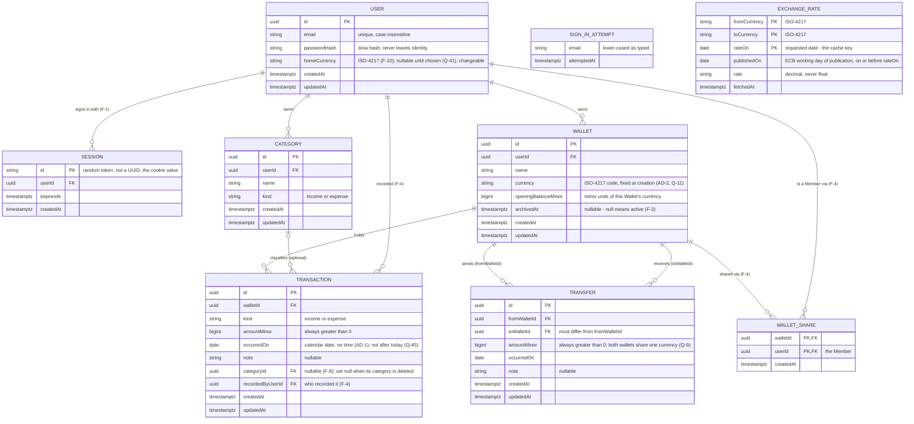

# Money Management — Entity Relationship Diagram

> Static structure of the epic in `epic.md`. Canonical names come from its Shared Domain Entities and
> Domain Language sections. Drafted 2026-10-28 by plan-epic; updated after grilling rounds 1–4 and the
> recheck rounds 5–7 (Sign-in Attempt, rate-cache rule, no future dates, Exchange Rate publication date, from/to Currency names,
> nullable Home Currency, fixed sign-in pause).
> Period Summary is computed on read and is deliberately not a table, so it is not drawn here.

## Notes

- **Balance is not a column.** A Wallet's Balance = `openingBalanceMinor` + Σ income − Σ expense +
  Σ transfers received − Σ transfers sent, computed on read (Project Conventions).
- **Category scope** (round 2, Q-5): per User, belongs to one Kind, optional on a Transaction
  ("Uncategorized"), none pre-loaded. Deleting a Category sets its Transactions' `categoryId` to null.
- **Wallets are never deleted** (archived instead), so no Transaction or Transfer can lose its Wallet.
- **Ownership** (round 1, A-1): Transactions and Transfers reach their User through their Wallet(s);
  Categories carry their own `userId`. A Transfer joins two Wallets both owned by the same User (Q-19).
- **Sharing** (round 3): a WALLET_SHARE row makes a User a Member of one Wallet. Members see it and
  record/edit/delete its Transactions (`recordedByUserId`); removing a Member keeps their Transactions.
- **Currency** (AD-2): every amount is in minor units of its Wallet's Currency. Amounts of different
  Currencies are never summed natively; F-10 converts through a cached EXCHANGE_RATE, never stored as
  an amount. A Transfer's two Wallets share one Currency (Q-9).
- **Sharing and edits** (Q-33, Q-34): Members record Transactions from F-4 and edit/delete them from
  F-5. An edit may change a Transaction's Wallet only to a Wallet the editor can see, of the same
  Currency, not archived (Q-34).
- **Keys** (Identity-key convention exceptions): SESSION has a random-token id, WALLET_SHARE and
  EXCHANGE_RATE have composite keys, SIGN_IN_ATTEMPT has no key (counted and deleted by `email`).
- Physical names follow the conventions: tables `users`, `sessions`, `sign_in_attempts`, `wallets`,
  `wallet_shares`, `transactions`, `categories`, `transfers`, `exchange_rates`; columns snake_case
  (`wallet_id`, `amount_minor`, `occurred_on`, …).

## Deferred Relationships

> Relationships the diagram shows whose target entity did not exist yet when the owning feature built its
> table. Maintained by `/project:create-seed-data` (Stage 9): a feature adds the missing foreign key in a
> NEW changeset once it creates the target, then removes the entry here.

_None pending._ F-1 created `users`, `sessions` and `sign_in_attempts` together, so `sessions.user_id -> users.id`
was completed in the same changeset set. Later features' references to `users` are created with their own tables
(the target already exists).
