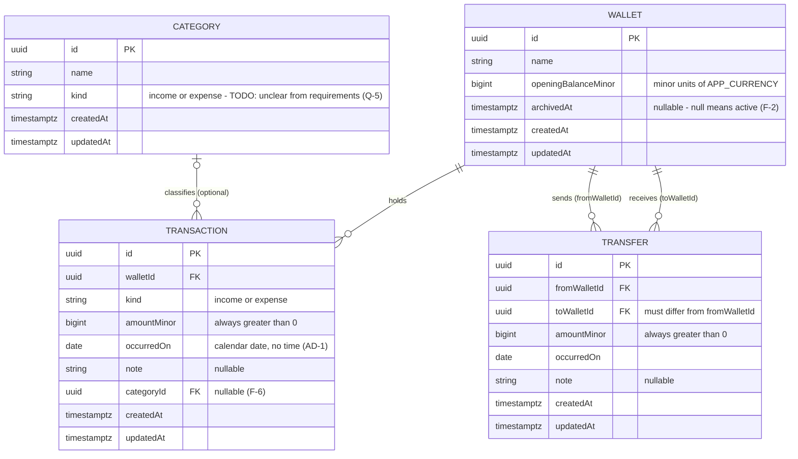

# Money Management — Entity Relationship Diagram

> Static structure of the epic in `epic.md`. Canonical names come from its Shared Domain Entities and
> Domain Language sections. Drafted 2026-10-28 by plan-epic — **not yet confirmed by the user**.
> Period Summary is computed on read and is deliberately not a table, so it is not drawn here.

## Notes

- **Balance is not a column.** A Wallet's Balance = `openingBalanceMinor` + Σ income − Σ expense +
  Σ transfers received − Σ transfers sent, computed on read (Project Conventions).
- **Category scope** — `{TODO: unclear from requirements}`: whether a Category belongs to a Kind
  (income vs expense), whether names are unique, and whether any Categories are pre-seeded (Q-5).
  Drawn as global (not per Wallet), optional on a Transaction.
- **Deleting a Category that Transactions use** — `{TODO: unclear from requirements}`: block the
  delete, or set those Transactions' `categoryId` to null. Settled with Q-5.
- **Wallets are never deleted** (archived instead), so no Transaction or Transfer can lose its Wallet.
- Physical names follow the conventions: tables `wallets`, `transactions`, `categories`, `transfers`;
  columns snake_case (`wallet_id`, `amount_minor`, `occurred_on`, …).
