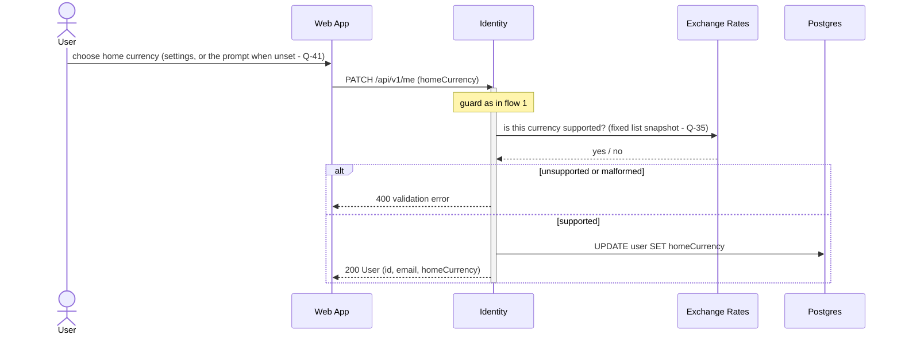
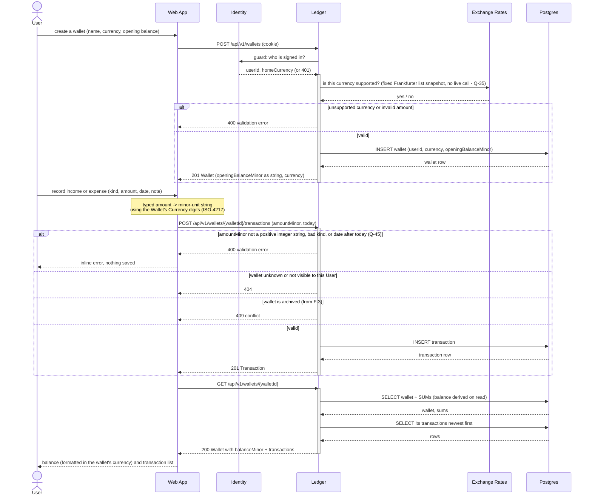
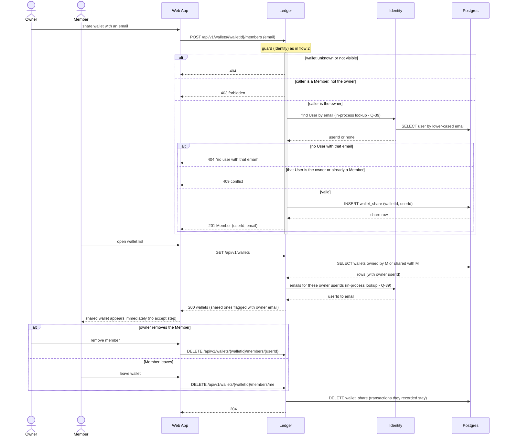
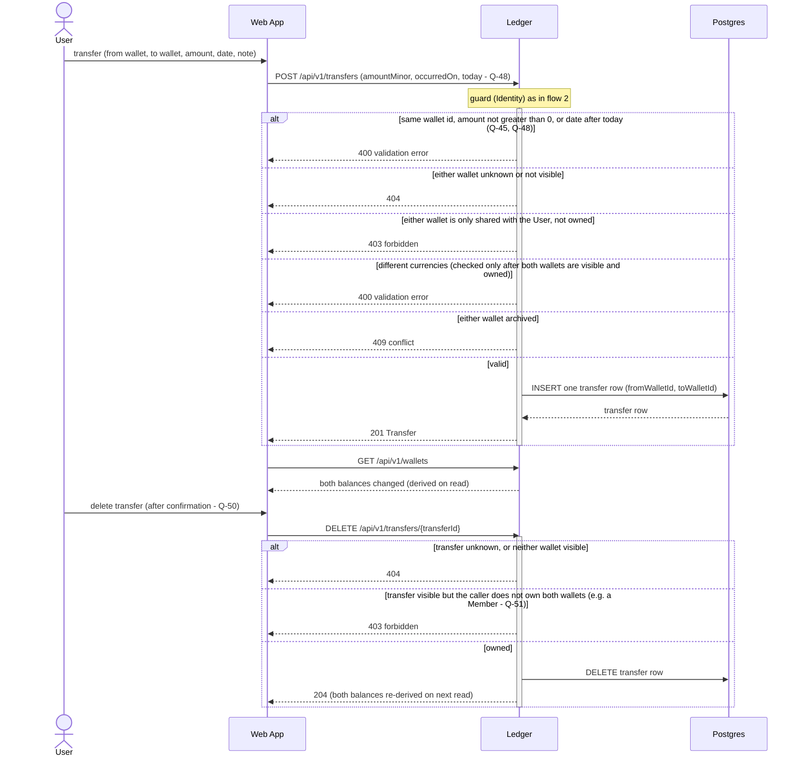

# Money Management — Sequence Diagrams

> Dynamic view of the epic in `epic.md`: the Service Architecture modules (Web App, Identity, Ledger,
> Summary, Exchange Rates, Postgres, Rate Provider) talking across their seams. Messages are calls that
> cross a seam — HTTP resource calls and SQL — never UI component detail (that belongs to each feature's
> `artifacts/F-n/02-flow.md`). Resource paths are indicative; Stage 2 fixes the exact endpoints.
> Drafted 2026-10-28 by plan-epic; updated through grilling rounds 1–6: multi-user, Currency per Wallet,
> sign-in as walking skeleton, same-Currency Transfers, Home Currency conversion (rounds 1–2); sharing,
> Frankfurter rates, AD-3 rate dates (round 3); sign-in attempts, Currency list from F-2, Converted
> Total condition, publication-day rates, guard yields Home Currency (round 5 recheck); Identity
> lookups, fixed sign-in pause, Converted Total on the all-wallets summary only, `today` on summary
> requests (round 6 recheck); Home Currency endpoint, 404-before-400 order, no future dates,
> server-time rate caching, per-Currency Category breakdown, three converted figures (round 7 recheck);
> `today` on writes and the Wallet Overview only, not on summaries (round 8 recheck); Transfer delete,
> Transfers in the wallet list, counterpart hidden from Members (rounds 9–11 recheck).

## 1. Sign up and sign in — F-1 (walking skeleton)

```mermaid
sequenceDiagram
    actor U as User
    participant W as Web App
    participant I as Identity
    participant DB as Postgres

    U->>W: sign up (email, password)
    W->>I: POST /api/v1/users
    activate I
    alt invalid email, password under 8 chars or missing a letter, number, or symbol, or unsupported homeCurrency (F-10)
        I-->>W: 400 validation error
    else email already registered
        I-->>W: 409 conflict
    else valid
        I->>DB: INSERT user (email, password hash)
        I->>DB: INSERT session (random id, userId, expiresAt = now + 30 days)
        I-->>W: 201 + Set-Cookie session id (httpOnly, SameSite=Lax)
    end
    deactivate I

    U->>W: sign in (email, password)
    W->>I: POST /api/v1/sessions
    activate I
    I->>DB: latest sign_in_attempt for the lower-cased email, and count of its attempts in the 15 min up to it
    alt count is 10 or more and the latest is under 15 min ago (fixed pause - Q-42)
        I-->>W: 429 too many attempts - try again at latest + 15 min (attempt not stored)
    else not paused
        I->>DB: SELECT user by email
        DB-->>I: user row or none
        alt unknown email or wrong password
            I->>DB: INSERT sign_in_attempt (lower-cased email, now())
            I-->>W: 401 (same message for both - no email enumeration)
        else ok
            I->>DB: DELETE sign_in_attempts for this email (Q-32)
            I->>DB: INSERT session (30-day sliding expiry)
            I-->>W: 200 + Set-Cookie session id
        end
    end
    deactivate I

    W->>I: GET /api/v1/me (cookie)
    I->>DB: SELECT session by id where expiresAt > now(); extend expiresAt
    I-->>W: 200 User (id, email, homeCurrency from F-10) or 401 -> Web App shows sign-in

    U->>W: sign out
    W->>I: DELETE /api/v1/sessions/current
    I->>DB: DELETE session
    I-->>W: 204 + cookie cleared
```

- Every later endpoint passes through Identity's guard first (flows 2–4 show it once as `guard`):
  no valid session → 401 and the Web App returns to sign-in. The guard yields `{ userId, homeCurrency }`
  (homeCurrency from F-10; null until chosen — Q-41). Identity also offers Ledger two in-process
  lookups — User by email, emails by User ids (Q-39, flow 2a) — so no other module reads `users`.
- Server time (session expiry, the 15-minute pause) is Postgres `now()`; there is no clock port (Q-37).
- From F-10 the sign-up call also carries `homeCurrency` (Q-20, Q-27), and `PATCH /api/v1/me
  {homeCurrency}` changes it. Both ask Exchange Rates "is this Currency supported?" (the same in-process
  check as flow 2); unsupported → 400. See flow 1a.

## 1a. Set the Home Currency — F-10



## 2. Record a Transaction and see the Balance — F-2



Flows that reuse this one rather than getting their own diagram:
- **F-3 Wallet Overview and Management** — `GET /api/v1/wallets` (every visible wallet with its derived
  balance, plus a Currency Total of the Balances of owned Wallets), `PATCH /api/v1/wallets/{walletId}`
  for rename and archive. Archive sets `archivedAt`; the 409 branch above starts applying.
- **F-5 Edit and Delete Transactions** — `PATCH` / `DELETE /api/v1/transactions/{transactionId}`, then
  the same balance re-read; owner and Members alike (Q-33). Changing a Transaction's Wallet is checked
  in this order: Wallet not visible → 404, different Currency → 400, archived Wallet → 409 (Q-34) — so
  a 400 never reveals an invisible Wallet. The edit carries `today`; a date after it → 400 (Q-45, Q-48).
- **F-10 Wallet Overview's Converted Total** — `GET /api/v1/wallets?today=YYYY-MM-DD` (the browser's
  local date, Q-37): when the User has a Home Currency and any owned Wallet with a non-zero Balance has
  another Currency (Q-47),
  Ledger asks Exchange Rates for today's rate per other Currency (same call and "unavailable" handling as
  flow 3, same server-time caching rule) and returns an "≈" Converted Total of the owned Balances —
  Home-Currency Balances counted as they are — or a notice (AD-3, Q-36). No Home Currency yet → no
  Converted Total; the Web App prompts the User to choose one (Q-41).
- **F-8 Categorize Transactions** — category create/list on Ledger (per User); a transaction's
  `categoryId` rides on the create/edit calls above. A category whose Kind differs from the
  transaction's is a 400. The summary breakdown is per Category, Kind and Currency (flow 3).
- **F-4 Share a Wallet** — its own flow below (2a); afterwards the "not visible to this User" 404
  branch above means "neither owner nor Member", and every created Transaction stores `recordedByUserId`.

## 2a. Share a Wallet — F-4



- Owner-only actions (rename, archive, share, remove a Member) called by a Member → 403; a Member may
  record Transactions in the Wallet (flow 2), and from F-5 edit and delete them like the owner (Q-33).
- A Wallet's transaction list shows "recorded by" the same way: Ledger collects the
  `recordedByUserId`s and asks Identity for their emails in one lookup (Q-18, Q-39).

## 3. Read a Period Summary — F-6 (month), F-7 (week), F-10 (Converted Total)

```mermaid
sequenceDiagram
    actor U as User
    participant W as Web App
    participant S as Summary
    participant R as Exchange Rates
    participant DB as Postgres
    participant P as Rate Provider

    U->>W: open summary (period, a date in it, optional wallet)
    W->>S: GET /api/v1/summaries?period=month&date=2026-10-15&walletId= (no today - Q-49)
    Note over S: guard (Identity) as in flow 2 - yields userId and homeCurrency
    activate S
    Note over S: resolve Period boundaries in-process<br/>month: 1st to last day<br/>week: Monday to Sunday
    alt unknown period or malformed date
        S-->>W: 400 validation error
    else wallet filter given but unknown or not visible
        S-->>W: 404
    else valid
        S->>DB: SELECT SUM(amount_minor) GROUP BY currency, kind<br/>WHERE occurred_on in Period, wallets the User OWNS<br/>(or the one selected wallet, if owned or shared; archived included)
        DB-->>S: income and expense sums per currency
        opt one wallet selected (F-9)
            S->>DB: SELECT SUM of transfers in / out for that wallet in Period
            DB-->>S: transfersInMinor, transfersOutMinor
        end
        opt categories present (F-8)
            S->>DB: SELECT SUM GROUP BY category, kind, currency for the same Period
            DB-->>S: per-category sums per currency (never mixed - AD-2)
        end
        opt all wallets only (Q-40), homeCurrency set (Q-41), and a wallet in another currency had income or expense in the Period (F-10, Q-36, Q-47)
            S->>DB: SELECT SUM per currency, kind, occurred_on (non-home currencies only)
            DB-->>S: daily sums per currency
            S->>R: rate for each (currency, date) to homeCurrency (AD-3)
            R->>DB: SELECT cached rates by requested date (rateOn)
            alt some not cached
                R->>P: GET rate for that date (Frankfurter; Mountebank impostor in tests)
                alt provider answers
                    P-->>R: latest rate published on or before the date (Saturday gives Friday - Q-38)
                    opt publishedOn = rateOn, or rateOn more than 1 day before server now() (Q-44)
                        R->>DB: INSERT rate keyed by requested date, with publishedOn
                    end
                else provider down or currency/date missing
                    P-->>R: error or no rate
                end
            end
            R-->>S: rates, or "unavailable" for named (currency, date) pairs
            Note over S: all rates present: converted income and expense =<br/>home-currency sums as they are + other daily sums x rate,<br/>decimal math, each half-even to home minor unit;<br/>converted net = converted income - converted expense (Q-46)<br/>any missing: no Converted Total, notice instead
        end
        S-->>W: 200 Period Summary (Currency Totals, transfer lines, Converted Total or notice)
    end
    deactivate S
    W-->>U: Currency Totals (and Converted Total), with previous / next period
```

- **F-7 Weekly Summary** is this same flow with `period=week`; only the boundary resolution differs.
- **Summary reads the Ledger's tables directly** (read-only SQL, no call into Ledger) — the accepted
  data-ownership exception, Q-6 in `epic.md`.
- **Transfers are never Income or Expense.** A one-wallet summary shows them as separate in/out lines;
  the all-wallets summary leaves them out (A-11).
- **F-10 Wallet Overview's Converted Total** is computed by **Ledger** (`GET /api/v1/wallets`, see the
  notes under flow 2), with the same Exchange Rates call, passing the browser's `today` as the date (AD-3, Q-37); same
  "unavailable" handling. When every included Wallet is already in the Home Currency, no Converted
  Total is shown and no rate is asked for (Q-36).
- A one-wallet summary never carries a Converted Total — it has one Currency (Q-40). A User with no
  Home Currency yet gets none either, and the Web App prompts them to choose one (Q-41).
- A Member's all-wallets summary covers only Wallets they own; a shared Wallet is summarised by
  selecting it (Q-19).

## 4. Transfer between Wallets — F-9



- From F-9, `GET /api/v1/wallets/{walletId}` (flow 2) also returns the Wallet's Transfers, interleaved
  with its Transactions newest first and marked "transfer in" / "transfer out"; Members of a shared
  Wallet see them read-only, and only the owner gets the delete action (Q-51). The other Wallet's name
  and id are included only when the caller can see that Wallet; otherwise the row carries just the
  direction and amount (Q-52).
- Transfers are never edited: to correct one, delete it and record it again (Q-50). Deleting from an
  archived Wallet is allowed — archive blocks only new Transactions and Transfers.

- One row per transfer means the two balance changes can never disagree — no pair of writes to keep
  in step, so no multi-statement database transaction is needed.
- Negative resulting balances are allowed (A-6); no branch refuses a Transfer that would make a
  Balance negative.
- Both ends must be Wallets the User owns (Q-19), so every Transfer stays "between your own wallets"
  and A-11 (all-wallets summary leaves transfers out) holds.
