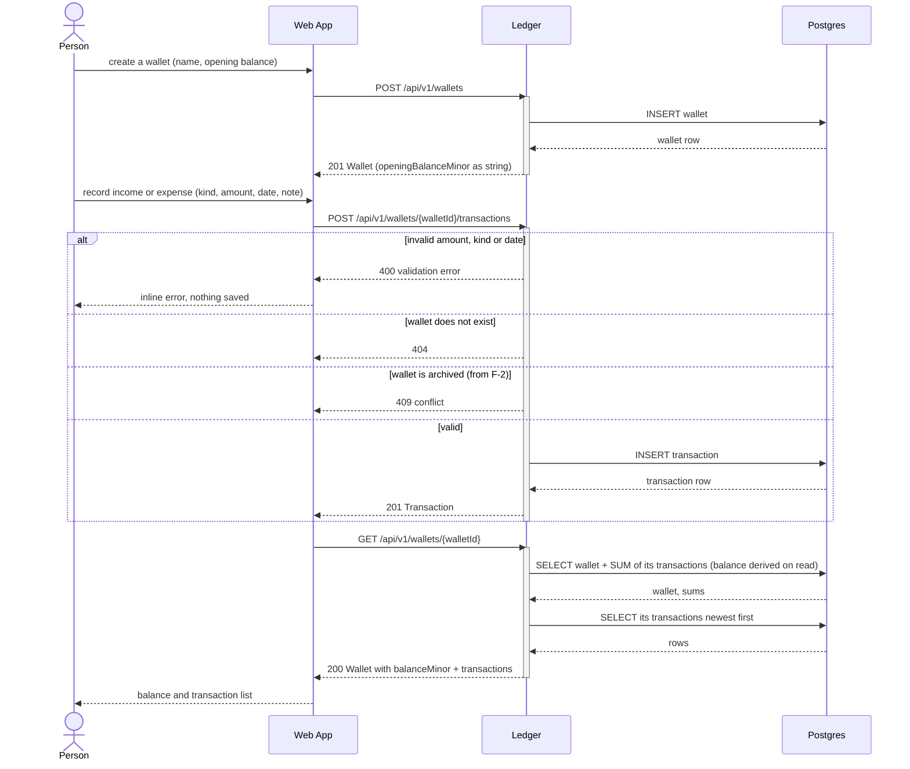
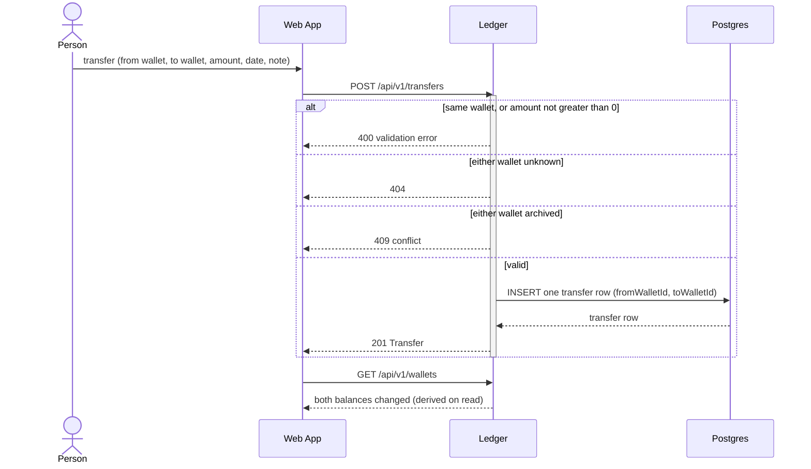

# Money Management — Sequence Diagrams

> Dynamic view of the epic in `epic.md`: the Service Architecture modules (Web App, Ledger, Summary,
> Postgres) talking across their seams. Messages are calls that cross a seam — HTTP resource calls and
> SQL — never UI component detail (that belongs to each feature's `artifacts/F-n/02-flow.md`).
> Resource paths are indicative; Stage 2 fixes the exact endpoints. Drafted 2026-10-28 by plan-epic —
> **not yet confirmed by the user**.

## 1. Record a Transaction and see the Balance — F-1 (walking skeleton)



Flows that reuse this one rather than getting their own diagram:
- **F-2 Wallet Overview and Management** — `GET /api/v1/wallets` (every wallet with its derived balance,
  plus the grand total), `PATCH /api/v1/wallets/{walletId}` for rename and archive. Same participants,
  same Web App → Ledger → Postgres path. Archive sets `archivedAt`; the 409 branch above starts applying.
- **F-3 Edit and Delete Transactions** — `PATCH` / `DELETE /api/v1/transactions/{transactionId}`, then
  the same balance re-read. Moving a transaction to an archived wallet is the same 409 branch.
- **F-6 Categorize Transactions** — category create/list on Ledger; a transaction's `categoryId` rides on
  the create/edit calls above. A category whose kind differs from the transaction's is a 400.

## 2. Read a Period Summary — F-4 (month), F-5 (week)

```mermaid
sequenceDiagram
    actor P as Person
    participant W as Web App
    participant S as Summary
    participant DB as Postgres

    P->>W: open summary (period = month or week, a date in it, optional wallet)
    W->>S: GET /api/v1/summaries?period=month&date=2026-10-15&walletId=
    activate S
    Note over S: resolve Period boundaries in-process<br/>month: 1st to last day<br/>week: Monday to Sunday (A-4)
    alt unknown period or malformed date
        S-->>W: 400 validation error
    else wallet filter given but unknown
        S-->>W: 404
    else valid
        S->>DB: SELECT SUM(amount_minor) GROUP BY kind<br/>WHERE occurred_on BETWEEN startsOn AND endsOn<br/>(and wallet_id = walletId if given; archived wallets included)
        DB-->>S: income sum, expense sum
        opt F-6 categories present
            S->>DB: SELECT SUM by category and kind for the same Period
            DB-->>S: per-category sums
        end
        S-->>W: 200 Period Summary (startsOn, endsOn, incomeMinor, expenseMinor, netMinor)
    end
    deactivate S
    W-->>P: totals, with previous / next period
```

- **F-5 Weekly Summary** is this same flow with `period=week`; only the boundary resolution differs.
- **Summary reads the Ledger's tables directly** (read-only SQL, no call into Ledger). This is the one
  place a module reads data it does not own — Q-6 in `epic.md`.
- **Transfers (F-7) are never in these sums**: they live in their own table and Summary does not read it.
  `{TODO: unclear from requirements}` — whether a summary filtered to one Wallet should also show that
  Wallet's transfers in and out as separate lines (a design-tree question, round 2).

## 3. Transfer between Wallets — F-7



- One row per transfer means the two balance changes can never disagree — there is no pair of
  writes to keep in step, so no multi-statement database transaction is needed.
- Negative resulting balances are allowed (A-6); no insufficient-funds branch.
